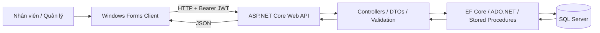

# 🛒 BÁCH HÓA GIA ĐÌNH BÀ TƯ

### Hệ thống quản lý bán hàng và tồn kho — ASP.NET Core Web API + Windows Forms + SQL Server

> **Đồ án môn học: Lập trình ứng dụng C# .NET Core**  
> **Đơn vị:** Trường Cao đẳng Công Thương TP. Hồ Chí Minh  
> **Giảng viên hướng dẫn:** Nguyễn Cao Thái  
> **Sinh viên thực hiện:** Phan Ngọc Hiếu — **MSSV:** 2124110126 — **Lớp:** CCQ2411D

[**Xem mã nguồn trên GitHub**](https://github.com/Phanhieuit/MiniSupermarket-BachHoaGiaDinhBaTu)

---

## 📌 1. Đồ án này làm gì?

**Bách hóa Gia đình Bà Tư** là phần mềm dành cho một cửa hàng bán lẻ/siêu thị mini. Nhân viên thao tác trên ứng dụng **Windows Forms (WinForms)**; dữ liệu và nghiệp vụ được xử lý tập trung qua **ASP.NET Core Web API** và lưu vào **Microsoft SQL Server**.

Ứng dụng tập trung giải quyết các công việc thường gặp tại cửa hàng:

- **Bán hàng tại quầy (POS):** nhập/quét mã vạch, thêm hàng vào giỏ, tính tiền, nhận tiền mặt và tính tiền thừa.
- **Quản lý danh mục và sản phẩm:** thêm, xem, cập nhật, xóa, tìm kiếm, lọc theo nhóm và phân trang.
- **Theo dõi tồn kho:** tự động trừ số lượng khi thanh toán thành công và tô màu cảnh báo sản phẩm có tồn kho **≤ 10**.
- **Khách hàng thành viên:** tra cứu theo số điện thoại, tích điểm và đổi điểm để giảm tiền hóa đơn.
- **Quản trị tài khoản:** đăng nhập bằng JWT, phân quyền Admin/Cashier/Warehouse ở các API phù hợp, khóa/mở tài khoản và đặt lại mật khẩu theo quyền.
- **Báo cáo quản trị:** 4 chỉ số KPI, biểu đồ doanh thu theo ngày/tuần/tháng, thống kê ca, Top 5 sản phẩm bán chạy và xuất CSV mở được bằng Excel.
- **Kiểm thử:** sử dụng Swagger để gọi API, đối chiếu dữ liệu SQL Server và thực hiện các kịch bản kiểm thử nghiệp vụ.

**Phạm vi:** ứng dụng *desktop* cho Windows; **không phải website thương mại điện tử**. Đây là đồ án học tập, chưa phải hệ thống được kiểm chứng đầy đủ để đưa vào vận hành thương mại.

### Luồng hoạt động cơ bản

1. Người dùng mở **WinForms**, đăng nhập tài khoản được cấp.
2. WinForms gọi `POST /api/Auth/login` để lấy **JWT Token** và quyền truy cập.
3. Thu ngân vào **POS**, quét hoặc nhập **Barcode** để tìm sản phẩm.
4. Người dùng thêm sản phẩm, điều chỉnh số lượng, chọn khách thành viên nếu có.
5. Thu ngân thanh toán, WinForms gửi `POST /api/orders/checkout`.
6. Web API kiểm tra dữ liệu và xử lý trong **SQL Transaction**: lưu hóa đơn, lưu chi tiết, trừ tồn kho và cập nhật điểm thành viên khi áp dụng.
7. Giao diện hiển thị kết quả; Admin xem thống kê và xuất báo cáo.

---

## 🧰 2. Công nghệ sử dụng

| Thành phần | Công nghệ | Vai trò |
|---|---|---|
| Ngôn ngữ | C# | Xây dựng toàn bộ chương trình |
| Backend | **ASP.NET Core Web API — .NET 8** | REST API, nghiệp vụ, xác thực, phân quyền |
| Desktop | **Windows Forms — .NET 8 (Windows)** | Giao diện đăng nhập, quản lý, POS, báo cáo |
| Cơ sở dữ liệu | **Microsoft SQL Server** | Lưu tài khoản, sản phẩm, khách hàng, hóa đơn |
| ORM | **Entity Framework Core 8** | DbContext, LINQ, Migration, Seed Data |
| Truy vấn trực tiếp | **ADO.NET** (`SqlConnection`, `SqlCommand`, `SqlDataReader`) | Tra cứu Barcode và xử lý giao dịch |
| Bảo mật | **JWT Bearer**, Role-Based Authorization | Đăng nhập và phân quyền API |
| Kiểm thử API | **Swagger/OpenAPI** | Liệt kê, gọi và kiểm tra endpoint |
| Biểu đồ | `WinForms.DataVisualization` | Biểu đồ cột doanh thu |
| Xuất dữ liệu | CSV UTF-8 | Báo cáo sản phẩm và hóa đơn mở bằng Excel |
| IDE | Visual Studio 2022 | Phát triển, chạy và gỡ lỗi |

### Kiến trúc hệ thống



- WinForms **không trực tiếp thực hiện thao tác bán hàng trên SQL Server**; yêu cầu được gửi qua Backend.
- Backend xác thực, kiểm tra quyền, xác thực dữ liệu, xử lý nghiệp vụ và đọc/ghi cơ sở dữ liệu.
- Giao dịch bán hàng sử dụng transaction để hạn chế tình trạng hóa đơn được lưu nhưng tồn kho hoặc điểm thưởng không được cập nhật đồng bộ.

---

## ✅ 3. Các chức năng chính

| Phân hệ | Chức năng người dùng | Mã nguồn tiêu biểu |
|---|---|---|
| Đăng nhập | Xác thực tài khoản, tạo phiên đăng nhập và lấy Role | `AuthController.cs`, `FormLogin.cs`, `SessionManager.cs` |
| Giao diện chính | Sidebar, Header, mở Form con, ẩn/hiện menu theo quyền | `FormMainShell.cs` |
| Danh mục | Danh sách, tìm kiếm, thêm, sửa, xóa | `CategoriesController.cs`, `FormCategoryManagement.cs` |
| Sản phẩm | CRUD, tìm theo Barcode/tên, lọc, phân trang, tồn kho | `ProductsController.cs`, `FormProductManagement.cs` |
| Khách hàng | Xem và tra cứu theo số điện thoại, quản lý thành viên | `CustomersController.cs`, `FormCustomerManagement.cs` |
| Bán hàng POS | Giỏ hàng, tổng tiền, tiền khách đưa, tiền thừa, thanh toán | `OrdersController.cs`, `FormPOS.cs`, `FormPOS.Payment.cs` |
| Điểm thưởng | Dùng 50 điểm giảm 50.000đ theo điều kiện, tích điểm sau mua | `OrdersController.cs`, `FormPOS.Payment.cs` |
| Tài khoản | Danh sách nhân sự, cấp tài khoản, đặt lại mật khẩu, khóa/mở | `UsersController.cs`, `FormUserManagement.cs` |
| Dashboard | Doanh thu hôm nay, số hóa đơn, khách mới, hàng sắp hết | `AnalyticsController.cs`, `FormAnalyticsDashboard.cs` |
| Báo cáo | Biểu đồ ngày/tuần/tháng, theo ca, Top 5, xuất CSV | `AnalyticsController.cs`, `ShiftReportsController.cs`, `FormAnalyticsDashboard.cs` |

### Phân quyền

| Vai trò | Quyền chính |
|---|---|
| **Admin** | Quản trị sản phẩm/danh mục, tài khoản, xem Dashboard và báo cáo; có thể sử dụng POS |
| **Cashier** | Sử dụng POS, xử lý hóa đơn và khách thành viên theo các API được cấp quyền |
| **Warehouse** | Các thao tác quản lý danh mục/sản phẩm được API cho phép theo Role |

**Lưu ý:** Quyền thực tế do các thuộc tính `[Authorize]` / `[Authorize(Roles = "...")]` trên từng Controller quyết định. Việc ẩn menu WinForms chỉ hỗ trợ trải nghiệm người dùng, **không thay thế kiểm tra quyền ở API**.

---

## 🗂️ 4. Cấu trúc mã nguồn

```text
MiniSupermarket-BachHoaGiaDinhBaTu/
│
├── MiniSupermarket.API/                  # Backend ASP.NET Core Web API
│   ├── Controllers/
│   │   ├── AuthController.cs             # Login / JWT
│   │   ├── CategoriesController.cs       # CRUD danh mục
│   │   ├── ProductsController.cs         # CRUD / Search / Filter / Paged / Barcode
│   │   ├── CustomersController.cs        # Khách hàng thành viên
│   │   ├── OrdersController.cs           # Đơn hàng / Checkout / báo cáo ngày
│   │   ├── UsersController.cs            # Quản lý nhân viên, tài khoản
│   │   ├── AnalyticsController.cs        # KPI / Biểu đồ / Top / CSV
│   │   └── ShiftReportsController.cs     # Báo cáo theo ca
│   ├── Data/
│   │   ├── SupermarketDbContext.cs       # EF Core / quan hệ / seed
│   │   └── PracticeDatabase.cs
│   ├── Database/                         # Script SQL phục vụ nghiệp vụ và báo cáo
│   ├── DTOs/                             # Request / Response DTOs
│   ├── Migrations/                       # Migration EF Core
│   ├── Models/                           # Entity classes
│   ├── Properties/launchSettings.json    # Cổng chạy API
│   ├── Program.cs                        # DI / JWT / Swagger / Middleware
│   └── MiniSupermarket.API.csproj
│
├── MiniSupermarket.WinForms/             # Desktop client
│   ├── FormLogin.cs
│   ├── FormMainShell.cs
│   ├── FormCategoryManagement.cs
│   ├── FormProductManagement.cs
│   ├── FormCustomerManagement.cs
│   ├── FormUserManagement.cs
│   ├── FormPOS.cs
│   ├── FormPOS.Payment.cs
│   ├── FormAnalyticsDashboard.cs
│   ├── SessionManager.cs
│   ├── Program.cs
│   └── MiniSupermarket.WinForms.csproj
│
├── DANH_SACH_SAN_PHAM_MAU.csv           # Dữ liệu mẫu, nếu có trong repo
├── KIEM_TRA_DATABASE.sql               # Truy vấn đối chiếu, nếu có
├── HUONG_DAN_TC26_DEN_TC35.md          # Tài liệu các tiêu chí, nếu có
├── HUONG_DAN_TC36_DEN_TC50.md          # Tài liệu các tiêu chí, nếu có
├── README.md
└── <file-solution>.sln                 # Mở Solution bằng Visual Studio
```

> Một số tài liệu hướng dẫn có thể không được đưa lên Repository tùy `.gitignore` và lần commit. Tên file Solution cần lấy đúng theo file `.sln` đang có trong thư mục gốc.

---

## 🚀 5. Hướng dẫn cài đặt và chạy từ đầu

### 5.1. Yêu cầu hệ thống

- **Windows 10/11** (WinForms chạy trên Windows).
- **Visual Studio 2022** với workload **ASP.NET and web development** và **.NET desktop development**.
- **.NET 8 SDK** (và .NET 8 Runtime).
- **SQL Server** (Developer/Express) và **SQL Server Management Studio — SSMS**.
- Git và kết nối Internet lần đầu để khôi phục các NuGet packages.

### 5.2. Tải mã nguồn

Mở PowerShell:

```powershell
git clone https://github.com/Phanhieuit/MiniSupermarket-BachHoaGiaDinhBaTu.git
cd MiniSupermarket-BachHoaGiaDinhBaTu
```

Mở file `.sln` ở thư mục gốc bằng **Visual Studio 2022**.

### 5.3. Tạo và cấu hình SQL Server

1. Mở SSMS và kết nối tới SQL Server đang chạy trên máy (`localhost`, `.` hoặc `localhost\\SQLEXPRESS` tùy môi trường).
2. Chuẩn bị database riêng cho việc học và thử nghiệm. Database dùng khi phát triển dự án là **`BachHoaGiaDinhBaTu_MigrationTestDb`**.
3. Tạo `MiniSupermarket.API/appsettings.json` từ file cấu hình mẫu, hoặc tạo thủ công với nội dung **ví dụ** dưới đây:

```json
{
  "ConnectionStrings": {
    "DefaultConnection": "Server=localhost;Database=BachHoaGiaDinhBaTu_MigrationTestDb;Trusted_Connection=True;TrustServerCertificate=True;"
  },
  "JwtSettings": {
    "Secret": "THAY_BANG_CHUOI_BI_MAT_NGAU_NHIEN_DU_DAI_CHI_DUNG_TREN_MAY_BAN"
  },
  "BootstrapAdmin": {
    "Password": "THAY_BANG_MAT_KHAU_DEMO_RIENG"
  },
  "Logging": {
    "LogLevel": {
      "Default": "Information",
      "Microsoft.AspNetCore": "Warning"
    }
  },
  "AllowedHosts": "*"
}
```

**Thay tất cả giá trị `THAY_BANG_...` trước khi chạy.** Nếu dùng SQL Server Express, thay `Server=localhost` bằng đúng tên instance thực tế. Không commit file chứa mật khẩu hoặc JWT secret vào Repository công khai.

**Lưu ý quan trọng về Migration:** API trong source có bước kiểm tra kết nối và **kiểm tra Pending Migrations khi khởi động**. Nếu database chưa cập nhật, API sẽ báo lỗi; cần chạy Migration ở bước kế tiếp trước khi mở Swagger.

### 5.4. Áp dụng Entity Framework Core Migrations

Trong Visual Studio, chọn **Tools → NuGet Package Manager → Package Manager Console**.

- Chọn **Default project:** `MiniSupermarket.API`.
- Chạy:

```powershell
Update-Database
```

Hoặc dùng Terminal từ thư mục gốc Repository:

```powershell
dotnet restore
dotnet ef database update --project .\MiniSupermarket.API\MiniSupermarket.API.csproj --startup-project .\MiniSupermarket.API\MiniSupermarket.API.csproj
```

Nếu Terminal báo `dotnet ef` không tồn tại, cần cài công cụ `dotnet-ef` tương ứng với EF Core 8 rồi chạy lại (hoặc dùng `Update-Database` trong Visual Studio).

Trong SSMS, kiểm tra các bảng `Users`, `Categories`, `Products`, `Customers`, `Orders`, `OrderDetails` và bảng `__EFMigrationsHistory`.

> **Không chạy lại script tạo bảng/seed một cách tùy tiện trên database đang có dữ liệu thật.** Hãy dùng database thử nghiệm và kiểm tra trạng thái Migration trước khi thao tác.

### 5.5. Chạy Backend Web API

Trong Visual Studio:

1. Chuột phải `MiniSupermarket.API` → **Set as Startup Project**.
2. Chọn profile **https**.
3. Nhấn **F5** hoặc **Ctrl + F5**.
4. Mở Swagger tại **<https://localhost:7237/swagger>**.

Hoặc dùng PowerShell:

```powershell
dotnet run --project .\MiniSupermarket.API\MiniSupermarket.API.csproj --launch-profile https
```

Nếu Windows chưa tin cậy chứng chỉ HTTPS phát triển:

```powershell
dotnet dev-certs https --trust
```

Cổng mặc định trong `launchSettings.json` là **HTTPS 7237**, còn địa chỉ HTTP phụ là **5142**. Nếu cổng bị thay đổi, phải sửa lại URL bên WinForms.

### 5.6. Chạy Frontend WinForms

1. **Giữ Backend API đang chạy**.
2. Mở `MiniSupermarket.WinForms/SessionManager.cs`.
3. Kiểm tra `ApiClientService.Client` đang sử dụng đúng API BaseAddress (theo bản source là `https://localhost:7237/api/`). Đồng thời kiểm tra các Form có cấu hình HTTP riêng nếu đã được tùy chỉnh.
4. Trong Visual Studio, chuột phải `MiniSupermarket.WinForms` → **Debug → Start New Instance** hoặc đặt WinForms làm Startup Project trong khi API vẫn chạy.
5. Màn hình `FormLogin` xuất hiện; đăng nhập bằng **tài khoản được cấp trong database thử nghiệm**.

Có thể cấu hình **Solution → Configure Startup Projects → Multiple startup projects** và chọn Start cho cả API lẫn WinForms.

### 5.7. Tài khoản đăng nhập

- Tài khoản và Role thực tế được lưu ở bảng `dbo.Users`.
- Môi trường **Development** có cơ chế tạo tài khoản `admin` ban đầu **khi** cấu hình `BootstrapAdmin:Password` và chưa tồn tại người dùng `admin`.
- Nếu đã có dữ liệu từ giai đoạn kiểm thử, tài khoản ví dụ như `admin01` hoặc `Cashier01` phụ thuộc vào cơ sở dữ liệu hiện tại.
- **Không đưa mật khẩu thật hoặc JWT token vào README.** Liên hệ người quản lý bản demo để nhận tài khoản thử nghiệm.

---

## 🧪 6. Hướng dẫn sử dụng từng chức năng

### 6.1. Đăng nhập và chuyển màn hình

1. Khởi động API và WinForms.
2. Tại `FormLogin`, nhập tài khoản/mật khẩu được cấp.
3. Nếu xác thực thành công, giao diện Shell được mở; menu hiển thị theo quyền.
4. Nhấn các mục Sidebar để đi đến **Bán hàng (POS)**, **Quản lý Danh mục**, **Quản lý Sản phẩm**, **Quản lý Khách hàng**, **Báo cáo Doanh thu**, **Quản trị Tài khoản** (tùy Role).

### 6.2. Quản lý danh mục

- Vào **Quản lý Danh mục** để xem danh sách.
- Gõ từ khóa → **Tìm kiếm**; chọn một dòng để hiển thị thông tin.
- Nhập tên/mô tả → **Thêm mới**; chọn danh mục rồi thay đổi dữ liệu → **Cập nhật**; **Xóa** danh mục thử nghiệm nếu không vi phạm ràng buộc.

### 6.3. Quản lý sản phẩm và tồn kho

- Vào **Quản lý Sản phẩm** để xem sản phẩm, Barcode, đơn giá, tồn kho và tên nhóm hàng.
- Tìm kiếm theo tên hoặc mã vạch; lọc theo danh mục.
- Nhập mã vạch (giữ dạng **chuỗi** để không mất số `0` ở đầu), tên, giá, tồn kho và nhóm hàng để thêm/sửa.
- Sản phẩm có `StockQuantity <= 10` được cảnh báo màu tại cột tồn kho.

### 6.4. Bán hàng POS (tiền mặt)

1. Vào **Bán hàng (POS)**, đặt con trỏ tại ô **Mã vạch** (có thể dùng **F8** theo giao diện).
2. Quét mã vạch hoặc nhập trực tiếp rồi nhấn **Enter**.
3. Kiểm tra tên sản phẩm, số lượng, đơn giá, thành tiền và tổng giỏ hàng.
4. Nếu có thành viên, nhập số điện thoại và nhấn **Tìm khách**; nếu không, chọn **Khách vãng lai**.
5. Nhập **tiền khách đưa**, hoặc chọn nút mệnh giá.
6. Kiểm tra tiền thừa; khi đủ tiền, nhấn **THANH TOÁN (F9)**.
7. Xem thông báo thành công với mã hóa đơn, tổng tiền và tiền thừa.

**Thanh toán sẽ ghi dữ liệu vào SQL Server và trừ tồn kho. Chỉ thực hiện giao dịch thử với dữ liệu thử nghiệm.**

### 6.5. Tích điểm / đổi điểm thành viên

- Khách hàng cần được tra cứu/xác nhận theo số điện thoại trước khi dùng điểm.
- Theo quy tắc triển khai trong đồ án: nếu đủ **50 điểm** và hóa đơn đáp ứng điều kiện, có thể chọn **dùng 50 điểm giảm 50.000đ**.
- Hệ thống tính tiền sau giảm, trừ điểm sử dụng và cộng điểm tích thêm sau thanh toán thành công.
- Những thay đổi liên quan hóa đơn, kho và điểm được xử lý trong nghiệp vụ Checkout của Backend.

**Ví dụ kiểm thử đã thực hiện trong đồ án:** Hóa đơn hàng 86.000đ, giảm 50.000đ, khách trả 100.000đ, còn phải thanh toán 36.000đ, tiền thừa 64.000đ; khách có 75 điểm trước khi mua, dùng 50, tích thêm 3 → còn 28 điểm.

### 6.6. Dashboard và báo cáo

1. Đăng nhập Admin → **Báo cáo Doanh thu**.
2. Xem bốn KPI: **Doanh thu hôm nay**, **Tổng hóa đơn**, **Khách mới hôm nay**, **Hàng sắp hết (≤10)**.
3. Chọn khoảng ngày và chế độ **Theo ngày / Theo tuần / Theo tháng** → **Làm mới**.
4. Kéo xuống xem **Top 5 sản phẩm bán chạy**.
5. Bấm **Xuất danh mục CSV** hoặc **Xuất hóa đơn CSV** để mở bằng Excel.

**Lưu ý Excel:** Với cột `Barcode`, nên nhập CSV qua **Data → From Text/CSV** và chọn kiểu dữ liệu **Text** để không mất số 0 ở đầu mã.

---

## 🌐 7. Danh sách 33 endpoint nghiệp vụ Web API

**Base URL trong môi trường Development:** `https://localhost:7237`  
**Swagger UI:** `https://localhost:7237/swagger`

Các endpoint dưới đây được tổng hợp từ Controller mã nguồn đồ án. Nhóm `WeatherForecast` có thể xuất hiện trong Swagger nhưng là mã mẫu khởi tạo project, **không tính vào 33 endpoint nghiệp vụ**.

| # | Method | Endpoint | Quyền | Chức năng |
|---:|:---:|---|---|---|
| 1 | POST | `/api/Auth/login` | Công khai | Đăng nhập và cấp JWT |
| 2 | GET | `/api/categories` | Đã đăng nhập | Danh sách danh mục |
| 3 | GET | `/api/categories/{id}` | Đã đăng nhập | Chi tiết danh mục |
| 4 | GET | `/api/categories/search?keyword=...` | Đã đăng nhập | Tìm danh mục |
| 5 | POST | `/api/categories` | Admin, Warehouse | Thêm danh mục |
| 6 | PUT | `/api/categories/{id}` | Admin, Warehouse | Cập nhật danh mục |
| 7 | DELETE | `/api/categories/{id}` | Admin, Warehouse | Xóa danh mục |
| 8 | GET | `/api/Products` | Đã đăng nhập | Danh sách sản phẩm |
| 9 | GET | `/api/Products/{id}` | Đã đăng nhập | Chi tiết sản phẩm |
| 10 | GET | `/api/Products/barcode/{barcode}` | Đã đăng nhập | Tra cứu mã vạch (ADO.NET) |
| 11 | GET | `/api/Products/search?keyword=...` | Đã đăng nhập | Tìm sản phẩm |
| 12 | GET | `/api/Products/filter?categoryId=...&minPrice=...&maxPrice=...` | Đã đăng nhập | Lọc sản phẩm |
| 13 | GET | `/api/Products/paged?pageNumber=1&pageSize=10` | Đã đăng nhập | Phân trang |
| 14 | POST | `/api/Products` | Admin, Warehouse | Thêm sản phẩm |
| 15 | PUT | `/api/Products/{id}` | Admin, Warehouse | Sửa sản phẩm |
| 16 | DELETE | `/api/Products/{id}` | Admin, Warehouse | Xóa sản phẩm |
| 17 | GET | `/api/customers` | Admin, Cashier | Danh sách khách hàng |
| 18 | GET | `/api/customers/phone/{phone}` | Admin, Cashier | Tra khách theo số điện thoại |
| 19 | POST | `/api/customers` | Admin, Cashier | Tạo khách hàng |
| 20 | GET | `/api/orders` | Admin, Cashier | Danh sách hóa đơn |
| 21 | GET | `/api/orders/{id}` | Admin, Cashier | Chi tiết hóa đơn |
| 22 | POST | `/api/orders/checkout` | Admin, Cashier | Thanh toán POS |
| 23 | GET | `/api/reports/daily?date=...` | Admin | Thống kê doanh thu ngày |
| 24 | GET | `/api/Users` | Admin | Danh sách tài khoản |
| 25 | POST | `/api/Users` | Admin | Tạo tài khoản |
| 26 | PUT | `/api/Users/{id}/reset-password` | Admin | Đặt lại mật khẩu |
| 27 | PUT | `/api/Users/{id}/toggle-lock` | Admin | Khóa / mở tài khoản |
| 28 | GET | `/api/reports/shift` | Admin | Thống kê doanh thu theo ca |
| 29 | GET | `/api/reports/dashboard-summary` | Admin | Bốn KPI |
| 30 | GET | `/api/reports/revenue-trend?period=day` | Admin | Biểu đồ doanh thu ngày/tuần/tháng |
| 31 | GET | `/api/reports/top-products?take=5` | Admin | Top sản phẩm bán chạy |
| 32 | GET | `/api/reports/export/products.csv` | Admin | Xuất danh mục sản phẩm CSV |
| 33 | GET | `/api/reports/export/orders.csv` | Admin | Xuất hóa đơn CSV |

> Các tên tham số có thể tùy chọn hoặc bắt buộc tùy endpoint. Khi kiểm thử, mở Swagger để xem đúng request schema của phiên bản source hiện tại.

### Mẫu request đăng nhập

`POST /api/Auth/login`

```json
{
  "username": "<tai-khoan-duoc-cap>",
  "password": "<mat-khau-rieng>"
}
```

Nếu thành công, API trả token và Role. Để gọi API cần xác thực, bấm **Authorize** trong Swagger, nhập JWT theo ô hướng dẫn rồi Execute endpoint.

### Mẫu request tạo sản phẩm (chỉ dùng dữ liệu TEST)

`POST /api/Products`

```json
{
  "barcode": "2900000000059",
  "productName": "San pham kiem thu README",
  "price": 35000,
  "stockQuantity": 20,
  "categoryId": 1
}
```

`categoryId` phải tồn tại; `barcode` phải chưa trùng sản phẩm hiện có.

### Mẫu request thanh toán POS (làm thay đổi dữ liệu)

`POST /api/orders/checkout`

```json
{
  "customerPhone": null,
  "cashReceived": 100000,
  "useRewardPoints": false,
  "items": [
    {
      "productId": 1,
      "quantity": 1,
      "unitPrice": 86000
    }
  ]
}
```

Đây là **ví dụ minh họa cho database thử nghiệm**, không phải dữ liệu bắt buộc. Chỉ Execute khi ProductId tồn tại, còn hàng, đơn giá phù hợp và bạn chấp nhận tạo hóa đơn/trừ tồn kho.

### Những HTTP status thường gặp

| Status | Ý nghĩa | Tình huống kiểm thử |
|:---:|---|---|
| **200** | OK | Lấy dữ liệu, thao tác thành công |
| **201** | Created | Tạo dữ liệu mới thành công (khi endpoint trả mã này) |
| **400** | Bad Request | Thiếu/không hợp lệ tham số, phân trang sai |
| **401** | Unauthorized | Chưa đăng nhập / JWT không hợp lệ |
| **403** | Forbidden | Có JWT nhưng không đúng Role |
| **404** | Not Found | Không tìm thấy mã sản phẩm hoặc tài nguyên |
| **409** | Conflict | Xung đột dữ liệu theo quy tắc của endpoint |

---

## 🗄️ 8. Thiết kế cơ sở dữ liệu

Hệ thống sử dụng sáu bảng chính:

| Bảng | Trường tiêu biểu | Ý nghĩa |
|---|---|---|
| `Users` | `UserId`, `Username`, `FullName`, `Role`, `IsActive`, `PasswordHash` | Tài khoản nhân viên |
| `Categories` | `CategoryId`, `CategoryName`, `Description` | Nhóm hàng |
| `Products` | `ProductId`, `Barcode`, `ProductName`, `Price`, `StockQuantity`, `CategoryId` | Sản phẩm/tồn kho |
| `Customers` | `CustomerId`, `CustomerName`, `PhoneNumber`, `MembershipRank`, `RewardPoints`, `RegisteredAtUtc` | Thành viên |
| `Orders` | `OrderId`, `CreatedAt`, `CashierUsername`, `CustomerId`, `TotalAmount`, `DiscountAmount`, `CashReceived` | Hóa đơn |
| `OrderDetails` | `OrderDetailId`, `OrderId`, `ProductId`, `ProductName`, `Quantity`, `UnitPrice` | Chi tiết từng hóa đơn |

Các quan hệ chính gồm `Products.CategoryId → Categories.CategoryId`, `Orders.CustomerId → Customers.CustomerId` (có thể null cho khách vãng lai) và `OrderDetails.OrderId → Orders.OrderId`. Các ràng buộc còn lại xem trực tiếp trong `SupermarketDbContext.cs` và SQL Server.

**Truy vấn kiểm tra nhanh trong SSMS:**

```sql
USE BachHoaGiaDinhBaTu_MigrationTestDb;
GO

-- Sản phẩm sắp hết kho
SELECT ProductId, Barcode, ProductName, StockQuantity
FROM dbo.Products
WHERE StockQuantity <= 10;

-- Năm hóa đơn gần nhất
SELECT TOP (5) OrderId, CreatedAt, CashierUsername,
       CustomerId, TotalAmount, DiscountAmount, CashReceived
FROM dbo.Orders
ORDER BY OrderId DESC;

-- Top 5 sản phẩm theo tổng số lượng bán
SELECT TOP (5)
    ProductId,
    MAX(ProductName) AS ProductName,
    SUM(Quantity) AS QuantitySold,
    SUM(Quantity * UnitPrice) AS Revenue
FROM dbo.OrderDetails
GROUP BY ProductId
ORDER BY QuantitySold DESC, ProductId ASC;
```

---

## 🧫 9. Kiểm thử và minh chứng đồ án

### Các kịch bản chính

| Nhóm | Thử nghiệm | Kết quả cần xác nhận |
|---|---|---|
| Xác thực | Login hợp lệ / sai tài khoản | 200 hoặc phản hồi lỗi phù hợp |
| Phân quyền | Không token / Cashier gọi API Admin | 401 / 403 |
| Danh mục | Thêm, đọc, sửa, xóa trên Swagger | Dữ liệu API và SQL đồng nhất |
| Sản phẩm | Tìm Barcode, lọc, phân trang | Dữ liệu đúng, lỗi khi tham số sai |
| Giá trị biên | `pageNumber=0`; `pageSize=101` | 400 |
| POS | Tính tổng tiền, đưa thiếu tiền, thanh toán thành công | Không cho thanh toán thiếu; hóa đơn được tạo khi hợp lệ |
| Tồn kho | Kiểm tra tại mức 9, 10, 11 | 9/10 cảnh báo; 11 không cảnh báo |
| Điểm thưởng | Đổi 50 điểm và tích điểm sau mua | Hóa đơn, số điểm, tồn kho khớp SQL |
| Dashboard | KPI, ngày/tuần/tháng, Top 5 | Số liệu khớp phép tổng hợp từ database |
| Xuất CSV | Xuất sản phẩm / hóa đơn | Mở được, đúng tiếng Việt, Barcode giữ số 0 khi nhập dạng Text |
| Transaction | Giao dịch lỗi sau khi bắt đầu transaction | Cần có bằng chứng Rollback, không phát sinh dữ liệu dở dang |

**Nguyên tắc báo cáo:** Chỉ đánh dấu **PASS** khi có ảnh/kết quả kiểm thử thực tế. Ví dụ, hệ thống từ chối thanh toán vì hết hàng trước khi `BeginTransaction` là một ca kiểm thử hợp lệ nhưng **chưa tự động chứng minh Rollback đã chạy**.

### Bằng chứng mẫu đã từng đối chiếu trong quá trình làm đồ án

Giao dịch đổi điểm của khách hàng thành viên trong môi trường thử nghiệm từng được đối chiếu giữa WinForms và SQL Server:

- Hóa đơn kiểm thử: `OrderId = 6`; khách hàng: `CustomerId = 8`.
- Giá trị hàng: `86.000đ`; giảm bằng điểm: `50.000đ`; thanh toán: `36.000đ`; tiền đưa: `100.000đ`; tiền thừa: `64.000đ`.
- Điểm: `75 → 28` (sử dụng 50, tích thêm 3).
- Sản phẩm ID 1: tồn kho `41 → 40` tại thời điểm kiểm thử.

**Các con số trên là dữ liệu lịch sử của một lần test, không cam kết phản ánh tình trạng database hiện tại.**

### Gợi ý ảnh để bổ sung vào Repository (không có sẵn trong README này)

Nếu muốn GitHub hiển thị trực quan, tạo thư mục `docs/screenshots/` rồi lưu ảnh theo tên:

| Tên ảnh gợi ý | Nội dung cần chụp |
|---|---|
| `01-swagger-endpoints.png` | Toàn bộ nhóm endpoint trong Swagger |
| `02-login.png` | FormLogin và giao diện Shell |
| `03-products.png` | Quản lý sản phẩm, tồn kho, Barcode |
| `04-pos.png` | Quầy POS có giỏ hàng |
| `05-checkout.png` | Thanh toán thành công |
| `06-dashboard.png` | Bốn KPI và biểu đồ doanh thu |
| `07-best-sellers.png` | Top 5 sản phẩm bán chạy |
| `08-sql-check.png` | Đối chiếu SQL Server |
| `09-csv.png` | File CSV sản phẩm hoặc hóa đơn |

Khi có ảnh, có thể chèn dòng sau vào README:

```markdown

```

Trước khi đưa ảnh lên Repository **Public**, cần kiểm tra để không đăng thông tin đăng nhập, JWT còn hiệu lực hoặc dữ liệu cá nhân không cần thiết.

---

## 🧭 10. Đối chiếu các nhóm tiêu chí đồ án

Project được phát triển theo bộ **50 tiêu chí**, từ cấu hình dự án cho đến Web API, WinForms và nghiệp vụ nâng cao. Tóm tắt nơi kiểm tra:

| Tiêu chí | Chủ đề chính | File/khối mã cần mở |
|---|---|---|
| **TC01–TC10** | Nền tảng, thiết lập và các bài thực hành đầu | Solution, cấu hình và báo cáo tiêu chí |
| **TC11–TC17** | Solution, SQL connection, Controller, HTTP, DTO, async, Swagger | `Program.cs`, `appsettings.json`, `Controllers/`, `DTOs/` |
| **TC18–TC22** | Entity, DbContext, validation, Migration, Seed | `Models/`, `Data/`, `DTOs/`, `Migrations/` |
| **TC23–TC27** | CRUD, tìm kiếm, phân trang, Include, AsNoTracking | `ProductsController.cs`, `CategoriesController.cs` |
| **TC28–TC31** | JWT, 401, phân quyền Role, Swagger Authorize | `AuthController.cs`, `Program.cs` |
| **TC32–TC35** | Barcode ADO.NET, SqlDataReader, Stored Procedure, Transaction | `ProductsController.cs`, `OrdersController.cs`, `ShiftReportsController.cs` |
| **TC36–TC40** | Shell, nhúng Form, login, menu theo quyền, HttpClient | `FormMainShell.cs`, `FormLogin.cs`, `SessionManager.cs` |
| **TC41–TC43** | DataGridView, POS, cảnh báo tồn kho | `FormProductManagement.cs`, `FormPOS.cs` |
| **TC44–TC46** | Dashboard KPI, biểu đồ, Top 5 | `AnalyticsController.cs`, `FormAnalyticsDashboard.cs` |
| **TC47–TC48** | Điểm thưởng, xuất CSV | `OrdersController.cs`, `AnalyticsController.cs`, `FormPOS.Payment.cs` |
| **TC49–TC50** | Demo tổng thể, thuyết minh và bảo vệ | Toàn bộ Solution + báo cáo đồ án |

> Danh sách trên giúp **tìm mã nguồn để trình bày**; không có nghĩa mọi trường hợp kiểm thử của cả 50 tiêu chí đều đã được tự động kiểm chứng. Để xem kết quả chi tiết, sử dụng tài liệu báo cáo và ảnh thử nghiệm của dự án.

---

## 🛠️ 11. Lỗi thường gặp và cách xử lý

| Hiện tượng | Nguyên nhân thường gặp | Hướng xử lý |
|---|---|---|
| WinForms báo không kết nối server | API chưa chạy hoặc sai cổng | Chạy API trước, kiểm tra Swagger và `SessionManager.cs` |
| Lỗi chứng chỉ HTTPS | Chứng chỉ Development chưa được tin cậy | `dotnet dev-certs https --trust` |
| API báo không kết nối database | Sai SQL instance / quyền Windows Authentication | Kiểm tra `DefaultConnection`, SSMS, dịch vụ SQL Server |
| API báo còn Pending Migrations | Chưa cập nhật database | Chạy `Update-Database` đúng project/database |
| Swagger trả 401 | Chưa có JWT hoặc token hết hạn | Đăng nhập lại và Authorize |
| Swagger trả 403 | JWT hợp lệ nhưng Role không đủ quyền | Dùng tài khoản có quyền hoặc chọn đúng endpoint |
| Swagger trả 400 | Body JSON sai, thiếu thuộc tính, sai giá trị | Xem schema/request trong Swagger và Response body |
| Tra Barcode trả 404 | Mã không tồn tại hoặc dùng sai số 0 đầu | Kiểm tra chính xác `Products.Barcode` trong SSMS |
| Không đăng nhập được | Tài khoản bị khóa / sai mật khẩu / chưa tạo dữ liệu đăng nhập | Kiểm tra tài khoản demo trong môi trường thử nghiệm |
| Biểu đồ không có dữ liệu | Khoảng ngày chọn không có đơn hàng | Chọn khoảng có hóa đơn và nhấn Làm mới |
| CSV mất số 0 đầu Barcode | Excel tự nhận Barcode thành số | Import bằng Data → From Text/CSV, đặt Barcode là Text |
| `dotnet ef` không nhận lệnh | Thiếu EF CLI tool | Cài `dotnet-ef` tương thích EF Core 8 hoặc dùng PMC |

---

## 🔐 12. Lưu ý bảo mật và giới hạn hiện tại

- Repository có thể công khai; **không commit** mật khẩu SQL Server, JWT Secret thật, token, bản sao database thật hay khóa riêng.
- File `appsettings.json` của máy phát triển nên nằm trong `.gitignore`; dùng `appsettings.example.json` với giá trị giả để hướng dẫn cài đặt.
- Source học tập có thể còn **fallback JWT secret** khi không khai báo cấu hình; không sử dụng cách này trong sản phẩm triển khai thật. Cần yêu cầu secret hợp lệ từ nguồn cấu hình an toàn.
- Chỉ mở Swagger cho môi trường phát triển hoặc cấu hình bảo vệ phù hợp khi triển khai.
- Nghiệp vụ Checkout, cập nhật tồn kho và điểm thưởng cần được kiểm thử thêm các tình huống cạnh tranh, mất kết nối, lỗi sau khi bắt đầu transaction, sao lưu/phục hồi trước khi sử dụng ở cửa hàng thực tế.
- Dữ liệu demo và các thông số thống kê có thể thay đổi sau mỗi lần kiểm thử.

### Hướng phát triển

- Kiểm thử tự động API/Integration và tải đồng thời nhiều quầy POS.
- Bổ sung xuất Excel `.xlsx`, in hóa đơn và hỗ trợ máy in bill.
- Quản lý nhập kho/phiếu nhập, kiểm kê và lịch sử biến động tồn kho chuyên sâu.
- Nâng cấp bảo mật, quản lý secret, audit log, sao lưu/phục hồi.
- Mở rộng dashboard, phân tích xu hướng và thống kê theo nhiều ca/cửa hàng.

---

## 👨‍💻 13. Thông tin đồ án & tác giả

| Thông tin | Nội dung |
|---|---|
| Tên đề tài | Nghiên cứu xây dựng hệ thống quản lý bán hàng và tồn kho tối ưu hóa hiệu năng — Bách hóa Gia đình Bà Tư |
| Môn học | Lập trình ứng dụng C# .NET Core |
| Trường | Cao đẳng Công Thương TP. Hồ Chí Minh |
| Giảng viên hướng dẫn | **Nguyễn Cao Thái** |
| Sinh viên thực hiện | **Phan Ngọc Hiếu** |
| MSSV | **2124110126** |
| Lớp | **CCQ2411D** |
| Nền tảng | ASP.NET Core Web API + Windows Forms + SQL Server |
| GitHub | <https://github.com/Phanhieuit/MiniSupermarket-BachHoaGiaDinhBaTu> |

**Mục đích:** phục vụ học tập, thực hành kỹ thuật Web API và bảo vệ đồ án môn học.

---

**📍 Bắt đầu nhanh:** Clone Repository → Cấu hình `appsettings.json` → Chạy EF Migrations → Mở API/Swagger → Chạy WinForms → Đăng nhập tài khoản demo → Thử POS → Xem Dashboard.
